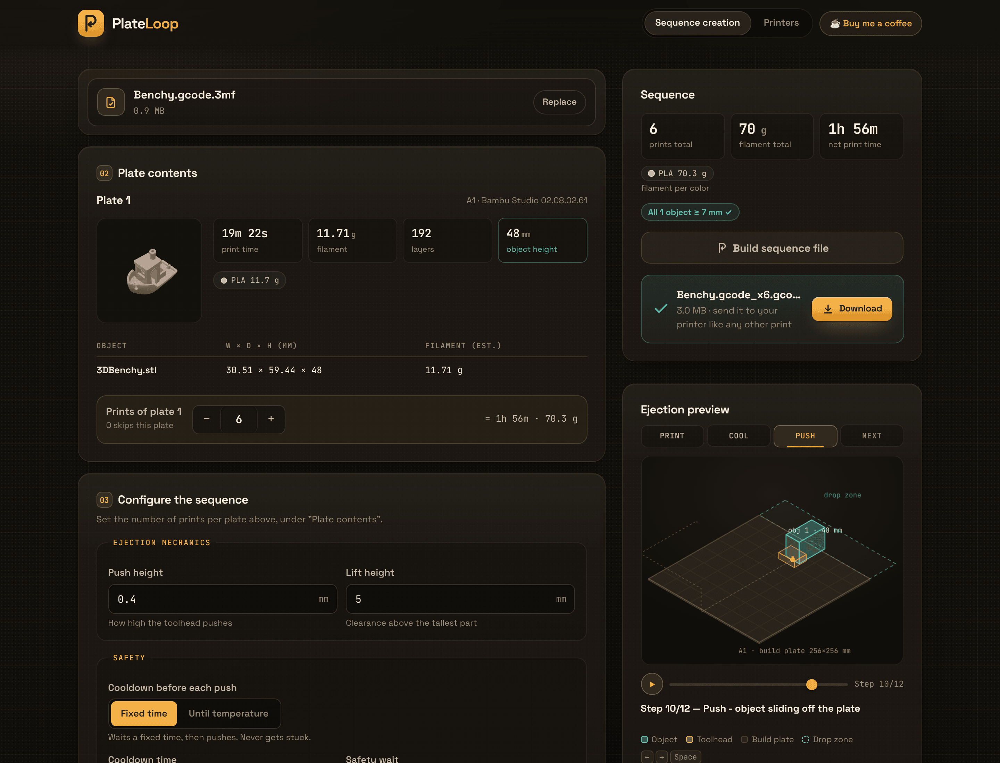
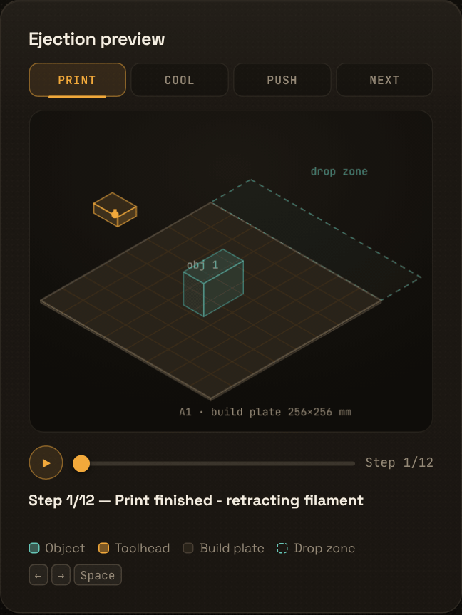
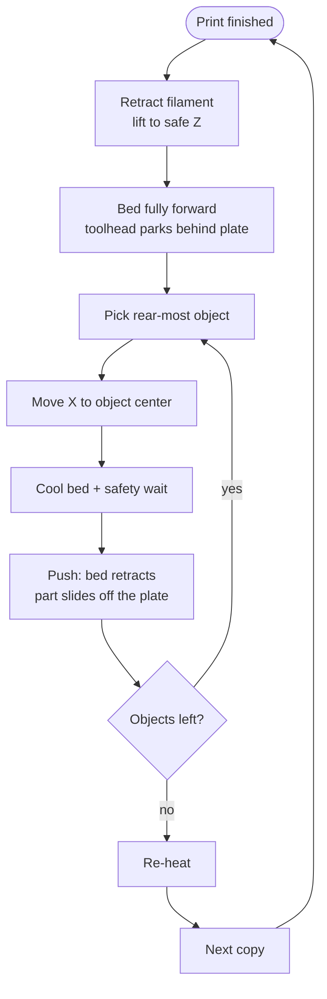
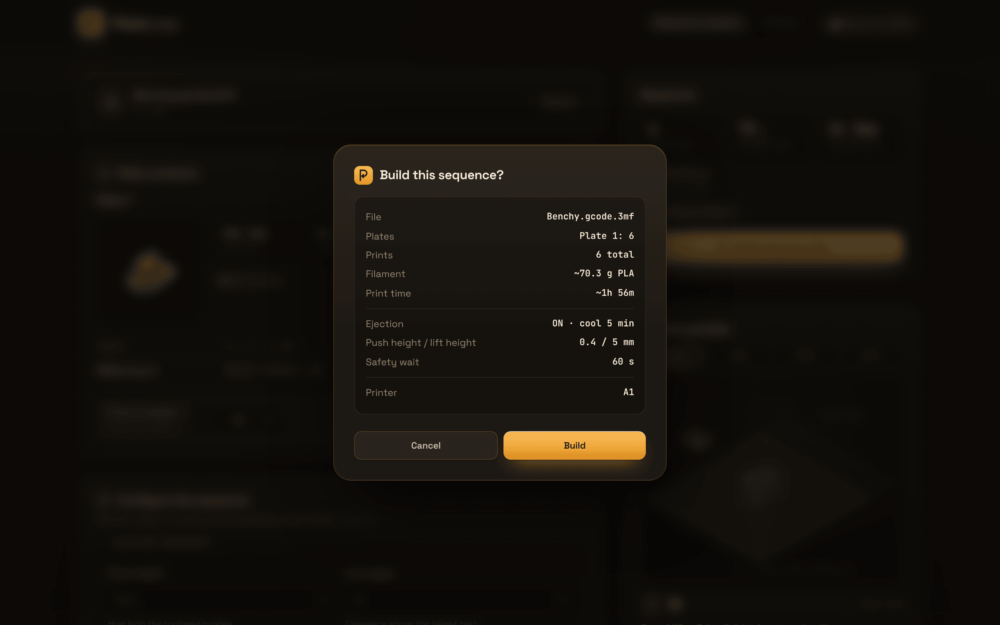
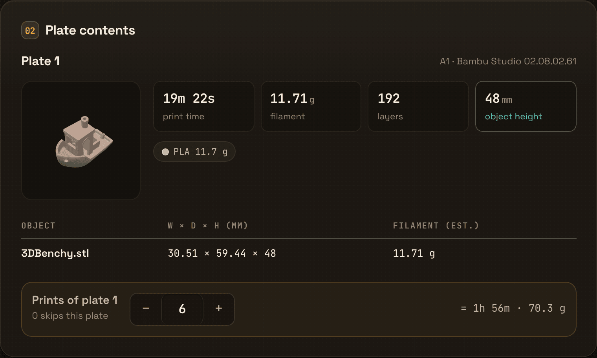
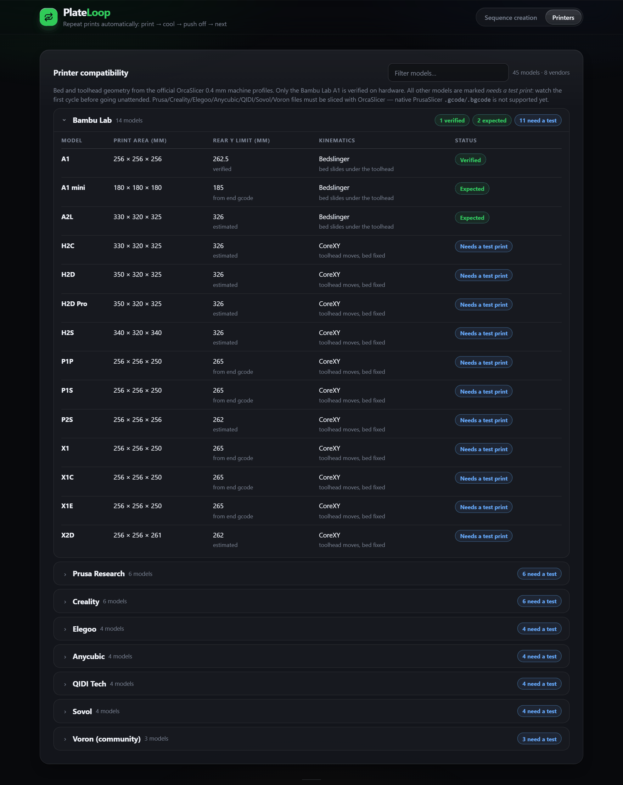

# PlateLoop

**Print. Eject. Repeat.**

PlateLoop is a self-hosted web app that turns a sliced `.gcode.3mf`
(Bambu Studio or OrcaSlicer) into an **automatic multi-copy print sequence**:
print → cool → the printer's own toolhead pushes the part off the plate into a
container → re-heat → next copy.

Push behaviour is **verified on the Bambu Lab A1**. The printer database also
covers Prusa, Creality, Elegoo, Anycubic, QIDI, Sovol and Voron geometry —
those models are honest about being *needs a test print*.

[](https://github.com/joshmadison/plateloop/actions/workflows/ci.yml) [](LICENSE) [](https://www.python.org/) [](https://www.docker.com/)

<p align="center">
  
</p>
<p align="center">
  <sub>Upload once, preview the real ejection, and download one file for the whole run.</sub>
</p>

## Demo

<p align="center">
  
</p>
<p align="center">
  <sub>Lift → park → cool → push → re-park. The preview uses the real object positions from your file.</sub>
</p>

## Features

- **One file, many copies.** Set the number of prints per plate and get a
  single `.gcode.3mf` that runs the whole sequence.
- **Multi-plate orchestration.** Configure every plate independently;
  `0` skips a plate. Plates run back to back without touching the printer.
- **No extra hardware.** The part is pushed by the printer's own toolhead —
  no ejector, conveyor or custom end effector.
- **Per-object ejection.** Multiple objects on one plate are pushed off one
  by one, rear-most first, with a lift and re-park between each push.
- **Printer-aware geometry.** 45 models across 8 vendor families (Bambu Lab,
  Prusa, Creality, Elegoo, Anycubic, QIDI, Sovol, Voron) with slicer-derived
  travel limits, park positions and toolhead clearance.
- **Safety guards.** Minimum part height, cooldown + safety wait, cooling
  checks and push-lane collision warnings before anything is built.
- **Local and private.** No account, no cloud, no telemetry. Uploads are
  processed in memory and nothing is written to disk.

## How it works



The generated file is a normal single-plate `.gcode.3mf`: the printer's
native start/end blocks are preserved, and the ejection sequence is inserted
between copies. The full motion design is documented in
[docs/ejection_logic.md](docs/ejection_logic.md); the animation frames are
validated against the generated gcode in the test suite.

## Quick start

### Docker (recommended)

```bash
git clone https://github.com/joshmadison/plateloop.git
cd plateloop
docker compose up -d
# open http://localhost:8080
```

The compose file ships sane defaults: non-root container, a 300 MB upload
cap, healthcheck and `restart: unless-stopped`. To raise the upload cap:

```yaml
environment:
  - MAX_UPLOAD_MB=600
```

### Local Python

```bash
git clone https://github.com/joshmadison/plateloop.git
cd plateloop
python -m venv venv

venv/Scripts/pip install -r requirements.txt   # Windows
venv/bin/pip install -r requirements.txt       # Linux / macOS

venv/Scripts/python -m app.main                # Windows
venv/bin/python -m app.main                    # Linux / macOS
# open http://localhost:8000
```

### Homeserver vs. public hosting

> [!NOTE]
> The app has no login. It binds to `0.0.0.0` inside the container. The plain
> `docker-compose.yml` is meant for your LAN. For a public instance, use the
> hardened Caddy setup in [`compose.prod.yaml`](compose.prod.yaml) and follow
> [`docs/DEPLOY.md`](docs/DEPLOY.md): rate limits, upload caps, a read-only
> container, TLS, subdomains and the legal pages are already prepared.

Uploads are processed in memory and nothing is persisted, so no volumes are
required. The container healthcheck requests `/` every 30 seconds.

## Usage

1. Slice your object in **Bambu Studio** (Bambu Lab) or **OrcaSlicer**
   (Bambu Lab *and* the other supported vendors).
2. Export **File → Export → Plate as .gcode.3mf** — or **All plates as
   .gcode.3mf** for a multi-plate run.
3. Upload the file, set the prints per plate, adjust the ejection settings
   and check the preview.
4. **Build sequence file**, download the `*_x<N>.gcode.3mf` and print it on
   your Bambu printer like any other file.

<p align="center">
  
</p>
<p align="center">
  <sub>Every build is summarized once more before the file is generated.</sub>
</p>

## Multi-plate files

Export with **All plates as .gcode.3mf** and upload it. Each plate gets its own
preview, object list and **prints** field (`0` = skip). The output is still a
single-plate `.gcode.3mf` whose gcode runs the plates back to back:

- every plate is printed as often as configured,
- every print is followed by that plate's ejection push,
- the first-print purge/calibration strip runs **once** for the whole sequence,
- homing and leveling still run before every print,
- the native shutdown runs only after the very last job.

<p align="center">
  
</p>

## Configuration

| Setting | Default | What it changes |
| --- | --- | --- |
| Prints per plate | `1` | Total copies for that plate. `0` skips it. |
| Push height | `0.4 mm` | Height of the toolhead edge above the plate during the push. |
| Lift height | `5 mm` | Extra clearance above the tallest object before moving. |
| Ejection bed temp | `45 °C` | Bed target for the cooldown before a part is pushed. |
| Safety wait | `60 s` | Dwell after the bed reaches the ejection temperature. |
| Min height check | `7 mm` | Rejects parts that are too short for a clean push. `0` disables the check. |

The download is named after your file, e.g. `model_x12.gcode.3mf` for 12
total prints.

## Public hosting

`compose.prod.yaml` runs PlateLoop behind Caddy with automatic HTTPS and is set
up for more apps on other subdomains:

```bash
cp .env.example .env   # set DOMAIN, ACME_EMAIL, support link, legal details
docker compose -f compose.prod.yaml up -d --build
```

The production stack includes per-IP rate limits, a global build cap, a
read-only container with memory/CPU limits, a 100 MB upload cap, security
headers and a `/docs` shutdown. The support button is enabled by default and
can be pointed at another page or hidden via `SUPPORT_URL`. The German legal
pages (`/impressum` and `/datenschutz`, legally binding) and their English
translations (`/imprint` and `/privacy`) are generated from `.env`; fill
`LEGAL_NAME`, `LEGAL_ADDRESS` and `LEGAL_EMAIL` before the site is public.

The full walkthrough — VPS hardening, DNS, adding future apps, backups,
Cloudflare caveats and the legal checklist — is in
[`docs/DEPLOY.md`](docs/DEPLOY.md).

## Safety first

> [!WARNING]
> **Never leave the printer unattended on the first full cycle.**
> PlateLoop changes the motion commands in the generated file. Watch the
> first complete print → eject → re-heat cycle for every new model or material.

- Point a container at the front of the printer; the part lands there.
- Parts must be tall enough for the toolhead to catch them. The default
  minimum is 7 mm; short parts can jam the toolhead.
- Objects sharing one push lane (overlapping X range) can cascade off together
  or jam. The app warns about these layouts before building.
- Push behavior is **verified on the Bambu Lab A1**. A1 mini and A2L share the
  same mechanics and are marked *expected*. CoreXY models (P1, P2, X1, X2 and
  H2 series) move the toolhead instead of the bed — plausible, but needs a
  test print.
- Prusa, Creality, Elegoo, Anycubic, QIDI, Sovol and Voron models have **no
  rear park zone** in their native end gcode: the pusher starts at the rear
  bed edge, so keep the rear-most part at least ~35 mm away from it. These
  models are all marked *needs a test print*.
- Verify plate adhesion, container placement and the first cycle for every
  material you use.

## Supported printers

The printer database ([`app/printers.json`](app/printers.json), provenance in
[docs/PRINTER_DB_SOURCES.md](docs/PRINTER_DB_SOURCES.md)) covers 45 models in
8 vendor families:

| Vendor | Models | Status |
| --- | --- | --- |
| Bambu Lab | A1, A1 mini, A2L, P1P, P1S, P2S, X1, X1C, X1E, X2D, H2S, H2D, H2D Pro, H2C | A1 *verified*, A1 mini/A2L *expected*, rest *needs a test print* |
| Prusa | MK4S, MK3S, MK3.5, MINI, CORE One, XL | needs a test print |
| Creality | K1, K1C, K1 Max, K2 Plus, Ender-3 V3, Ender-3 V3 KE | needs a test print |
| Elegoo | Centauri, Centauri Carbon, Neptune 4 Pro, Neptune 4 Max | needs a test print |
| Anycubic | Kobra 3, Kobra 3 Max, Kobra S1, Kobra S1 Max | needs a test print |
| QIDI | Q1 Pro, X-Plus 4, X-Max 4, Q2 | needs a test print |
| Sovol | SV06 ACE, SV08, SV08 MAX, Zero | needs a test print |
| Voron | 2.4 350, Trident 300, 0.1 | needs a test print |

Filenames and printer-model identifiers from Bambu Studio and OrcaSlicer are
resolved automatically — you never pick a printer manually. Unknown models
fall back to A1 geometry and show a warning instead of silently assuming the
wrong values. Each model's rear Y limit is tagged `verified`, `from end gcode`,
`no park zone` or `estimated`, so you can see what is proven.

> Non-Bambu files must be sliced with **OrcaSlicer** and exported as
> `.gcode.3mf`. Native PrusaSlicer `.gcode` / `.bgcode` is not supported yet.
> The Printers page groups models by vendor and marks what still needs a test
> print on real hardware.

<p align="center">
  
</p>

### Help verify a printer

Only the Bambu Lab A1 is verified on real hardware today; 42 of the 45 models
are still marked *needs a test print*. If you own one of them, you can help:

1. Read the [printer test protocol](docs/PRINTER_TEST_PROTOCOL.md).
2. Run a supervised three-copy test with a simple part.
3. Submit a [printer verification report](https://github.com/joshmadison/plateloop/issues/new?template=printer-verification.yml)
   with the details you have. Video and photos are optional; a short written
   report is enough to start the review.

Reports are reviewed before a model is marked *verified*. A failed test is
useful too: it documents the model's limits.

## Development

```bash
pip install -r requirements.txt -r requirements-dev.txt
python -m pytest tests -q          # 60 tests
python -m ruff check app tests     # lint
```

### Project layout

| Path | Purpose |
| --- | --- |
| `app/main.py` | FastAPI routes, upload limits, request validation |
| `app/gcode.py` | Ejection sequence, animation keyframes, multi-plate merge |
| `app/gcode_bbox.py` | Object bounding boxes, push-lane conflicts, print-end position |
| `app/threemf.py` | 3MF parsing, statistics, thumbnails, single-plate repack |
| `app/printer_db.py` | Printer database loader and model resolution |
| `app/printers.json` | Bed, kinematics and toolhead geometry per printer |
| `app/static/index.html` | Self-contained web UI and canvas preview |
| `tests/` | API and pipeline tests, including animation/gcode parity |

Ejection changes must keep `test_keyframes_mirror_gcode` green: the preview and
the generated gcode are validated against each other. To add a printer, extend
`app/printers.json` and document where every value comes from in
[docs/PRINTER_DB_SOURCES.md](docs/PRINTER_DB_SOURCES.md).

## Troubleshooting

**“This looks like a project 3MF without sliced gcode.”**
The upload contains a project, not a sliced plate. Slice it first, then use
*File → Export → Plate as .gcode.3mf*.

**“Object height … is below required 7 mm.”**
The jam guard rejected the build. Slice a taller object or lower the minimum
height — but check the first cycle closely if you do.

**“Printer … is not in the printer database.”**
The app falls back to A1 geometry so it can still build a file. Confirm the
park positions for your model before printing, or add the model to
`app/printers.json`.

**“Objects share the same push lane.”**
Their X ranges overlap, so the rear object may shove the front one along or
jam. Rearrange the plate, or watch the first cycle closely.

**Upload fails with HTTP 413.**
Increase `MAX_UPLOAD_MB` (Docker: see [Quick start](#quick-start)).

**Port 8000 is already in use.**
Start the local server with `PORT=8001 python -m app.main` (Linux/macOS) or
`$env:PORT=8001; python -m app.main` (PowerShell).

## Contributing

Issues and pull requests are welcome. Before opening a PR:

- run `python -m pytest tests -q` and `python -m ruff check app tests`,
- keep ejection changes covered by tests — especially the gcode/animation
  parity test,
- document new printer data with its source.

## License

MIT — see [LICENSE](LICENSE).

PlateLoop moves your printer's toolhead and bed. Verify container placement,
plate adhesion and the first full cycle for every material and model. Use at
your own risk.
